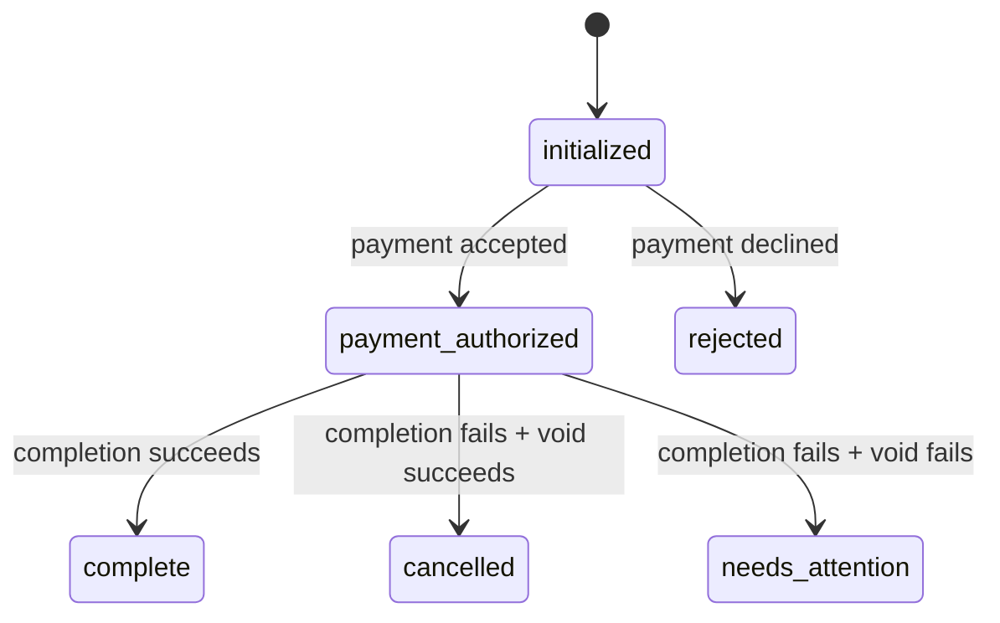

# Gametime Order State Machine

A small Java API that models checkout order transitions and recovers differently depending on **when** a failure occurs. This is a prototype for Gametime's take-home assessment, not a payment-processing system.

**Why this matters:** If payment is declined, there is nothing to undo. If ticket completion fails *after* payment authorization, we need to void that authorization. If the void fails too, the order must be flagged for a person to resolve, rather than incorrectly reported as cancelled.

## What I built

- Explicit order states with a whitelist of legal transitions.
- Timestamped history of creation and every successful state transition, including a short reason.
- Separate payment (`PaymentGateway`) and ticket-completion (`TicketFulfillment`) interfaces; in-memory stubs simulate the four requested outcomes.
- An HTTP API for creating an order, authorizing payment, attempting completion, and inspecting current state and history.
- Tests for all four scenarios plus illegal transitions and an HTTP-level partial-failure case.

## Approach

1. **Keep state rules in the `Order` model.** The only permitted transitions are in one `switch`; no controller or payment stub is allowed to change an order's state directly.
2. **Make the stage drive recovery in `OrderService`.** Authorization failure goes to `rejected` with **no void**. A later completion failure invokes `payment.voidAuthorization()` before choosing `cancelled`.
3. **Never hide a failed compensation.** If voiding fails, persist `needs_attention` with both failure reasons, log the partial failure, and return an explicit error to the API caller. The order remains queryable.
4. **Keep external services replaceable.** `StubExternalServices` implements the interfaces for reproducible demos; the state machine doesn't know about demo scenarios.
5. **Keep the prototype small.** It runs with the JDK alone: no database, message broker, third-party JSON library, or application framework is necessary to demonstrate the requirements.

### State diagram



`complete`, `rejected`, `cancelled`, and `needs_attention` have no further automated transitions in this prototype. Manual resolution is deliberately **not** implemented because the prompt asks us to *surface* partial failures, not define a human resolution workflow.

### How to run

Requires **JDK 21** and a shell (`bash`). No Maven or Gradle installation is needed.

```bash
./run.sh
```

The API starts at `http://localhost:8080`. To use another port, run `PORT=9090 ./run.sh`.

In a separate terminal:

```bash
# Create an order. The default scenario is HAPPY_PATH.
curl -i -X POST http://localhost:8080/orders

# Copy the "id" value from the response above.
ORDER_ID=<paste-the-uuid-here>

# Advance through checkout.
curl -i -X POST "http://localhost:8080/orders/$ORDER_ID/authorize"
curl -i -X POST "http://localhost:8080/orders/$ORDER_ID/complete"

# Retrieve current state and timestamped history.
curl -i "http://localhost:8080/orders/$ORDER_ID"
```

### Try each failure scenario

To simulate a failure, create a **new** order with one of these demo-only `scenario` values. Each order's behavior stays consistent for subsequent API calls.

| Scenario on `POST /orders?scenario=...` | After `/authorize` | After `/complete` | Void attempted? |
| --- | --- | --- | --- |
| `HAPPY_PATH` | `payment_authorized` (`200`) | `complete` (`200`) | No |
| `PAYMENT_DECLINED` | `rejected` (`422`) | Do not call: invalid transition (`409`) | No |
| `COMPLETION_FAILURE_VOID_SUCCESS` | `payment_authorized` (`200`) | `cancelled` (`422`) | Yes, succeeds |
| `COMPLETION_FAILURE_VOID_FAILED` | `payment_authorized` (`200`) | `needs_attention` (`502`) | Yes, fails |

Example: simulate the important partial-failure case.

```bash
curl -i -X POST \
  'http://localhost:8080/orders?scenario=COMPLETION_FAILURE_VOID_FAILED'
# Copy id -> set ORDER_ID as above, then authorize and complete it.
```

**API summary**

| Method | Route | Purpose |
| --- | --- | --- |
| `POST` | `/orders` | Create an order (`initialized`); optional demo-only scenario query parameter |
| `POST` | `/orders/{id}/authorize` | Ask payment stub to authorize; may reject |
| `POST` | `/orders/{id}/complete` | Attempt ticket completion; void on failure |
| `GET` | `/orders/{id}` | Read current state and history |

Response shapes:

- Successful action: `{ "id": "...", "state": "...", "history": [ ... ] }`
- Expected checkout failure: `{ "error": "...", "message": "...", "order": { ... } }`
- Invalid transition: `409`, missing order: `404`, malformed input: `400`.
- `422` means the requested checkout action failed, even when the recovery succeeded and left the order safely rejected/cancelled.
- `502` means the payment void failed after completion failed; **look at the returned order's `needs_attention` state** and the server log.

Each history item contains `from`, `to`, `at` (UTC ISO-8601 timestamp), and `reason`. The first item records creation (`from: null`).

The query parameter is **only a deterministic demo control**. A real API would not allow customers to choose whether a provider succeeds or fails. I used query parameters here to avoid building JSON request parsing for a prototype that has no domain-specific creation fields.

### How to test

```bash
./test.sh
```

The tests require only Java, run without a test framework download, and return a nonzero exit code if an assertion fails. They cover:

1. Happy path: `initialized → payment_authorized → complete`.
2. Payment decline: goes to `rejected`; **no void**.
3. Completion failure with successful void: goes to `cancelled`.
4. Completion failure with failed void: goes to `needs_attention`; error is thrown and retained in history.
5. Illegal transition and terminal-state protection.
6. HTTP behavior for payment decline, successful void recovery, failed void, history retrieval, and invalid requests.

### Code map

- `Order.java`, `OrderState.java`, `StateChange.java` — state machine and audit history.
- `OrderService.java` — payment/fulfillment orchestration and stage-dependent compensation.
- `PaymentGateway.java`, `TicketFulfillment.java` — replaceable external-service contracts.
- `StubExternalServices.java`, `DemoScenario.java` — deterministic demo behavior only.
- `OrderHttpServer.java` — minimal HTTP adapter and response/error serialization.
- `OrderTests.java` — unit and HTTP integration tests.

## Assessment checklist

| Requirement in the PDF | Where it is handled |
| --- | --- |
| Model states and enforce valid transitions | `OrderState`, `Order.transitionTo`, invalid-transition test |
| Keep timestamped state history | `StateChange`, `Order.snapshot`, API `history` |
| Happy path (`initialized → payment_authorized → complete`) | `OrderService`, happy-path test |
| Reject declined payment without cleanup | `OrderService.authorize`, decline/no-void test |
| Void after completion fails | `OrderService.complete`, successful-void test |
| Surface void failure as `needs_attention` | `PartialFailureException`, server `502`, failed-void test |
| API: create, advance, inspect state/history | `OrderHttpServer`, HTTP test and curl examples |
| Stub payments behind an interface | `PaymentGateway`, `StubExternalServices` |
| Explain why, tradeoffs, and future work | README sections here |
| Document AI use and validation | `AI_USAGE.md` |

## Tradeoffs and reasoning

**In-memory storage instead of a database.** This makes the prototype easy to run and review. The downside is that orders and their history disappear on restart; there is no durability across instances.

**Synchronous recovery instead of a job/queue.** An attempted void runs immediately after a completion failure so the recovery path is easy to trace. A real provider may time out or report an unknown status; this prototype only models the explicit success/failure cases in the prompt.

**Terminal `needs_attention` instead of automatic retries.** Retrying a payment void without a clear idempotency contract can cause confusion. This prototype retains the problematic order for human handling rather than inventing retry policy or a manual-resolution API.

**Built-in HTTP server instead of Spring Boot.** The focus is state transitions and correctness, not framework configuration. The domain interfaces can be reused from a Spring Boot controller or other web stack without rewriting the failure logic.

**Per-order in-process synchronization.** This prevents concurrent requests within one process from applying conflicting state transitions, but is not distributed locking. An actual multi-instance application needs a durable concurrency strategy.

## With more time

1. Persist orders and transitions transactionally with optimistic locking so restarts and multiple workers cannot lose or overwrite state.
2. Add idempotency keys and provider transaction IDs to protect payment authorization/void operations during retries and ambiguous timeouts.
3. Route `needs_attention` cases into an operations queue with clear ownership, auditability, alerts, and a defined manual resolution process.
4. Add integration/contract tests against a payment sandbox, plus structured metrics and tracing of completion/void failures.

These are **not** implemented because the assessment asks for a working ~3-hour prototype, not a production distributed checkout platform.

## AI use

See [AI_USAGE.md](AI_USAGE.md) for what AI assisted with, how the generated code was checked, and what still needs the submitting developer's personal review.
